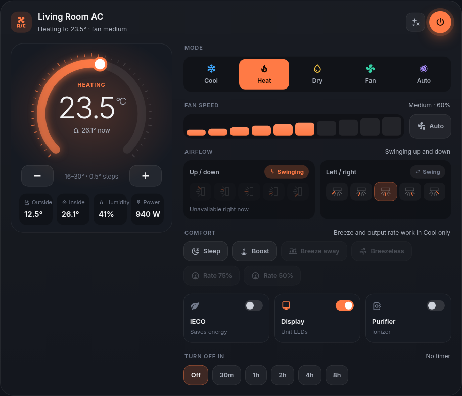
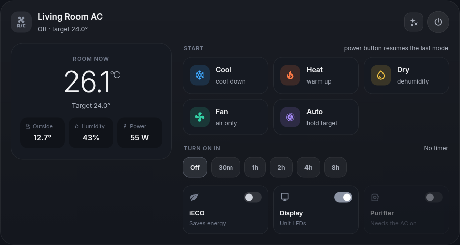
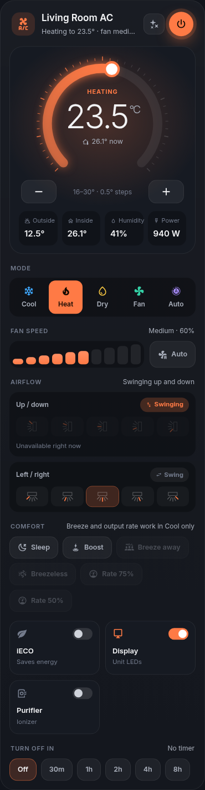

# Midea AC card for lovelace

`custom_card_gil_ac` is a standalone JavaScript Lovelace card that replicates the look and feel of the official **Midea app** for Home Assistant `climate` entities.

> **Required integration:** This card is designed specifically for the [**Midea Smart AC**](https://github.com/gilbertorconde/midea-ac) custom integration (a fork of [mill1000/midea-ac-py](https://github.com/mill1000/midea-ac-py) with extended features), which controls Midea (and associated brands — Carrier, Toshiba, Samsung, LG, Electrolux, and many more) air conditioners via LAN. Install it via HACS or manually before using this card.

Key features at a glance:

- **One page, any width** — two columns when the card is at least 660 px wide (e.g. in a dialog), one scrolling column on a phone. No bottom sheets.
- **270° thermostat dial** — drag the handle or use the +/− buttons under it (0.5 °C steps); arc, ticks and glow follow the HVAC mode colour.
- **Stats** — outdoor and indoor temperature, humidity and power draw (each shown only when available).
- **Mode control** — one segment per HVAC mode from `hvac_modes`, in a fixed natural order.
- **Fan bars** — drag or tap for an exact % via the `fan_speed` number entity, or the nearest fan mode without it; Auto chip.
- **Airflow** — up/down and left/right louver groups, each with its own swing toggle; tap the active position again to release it. Shows the actual louver angles when the diagnostic sensors are enabled.
- **Comfort chips** — Sleep / Boost / Away presets, Breeze away / Breezeless and output rate (Cool only, greyed out otherwise).
- **Toggles** — iECO (the `eco` preset), Display, Purifier, Flash.
- **Timers** — "Turn off in" while running, "Turn on in" while off.
- **Off state** — room temperature plus one-tap starts for each mode; the power button resumes the last mode.
- **Header** — filter and water-tank alerts, self-clean button (pulses while cleaning, works while off), power button.
- **More comfort / Diagnostics** — expandable sections that appear only for the extended entities you enabled.
- **Zero external dependencies** — single vanilla-JS file, no HACS frontend card required.
- **Auto-derived companion entities** — companion entity IDs are generated automatically from the climate entity name; only override the ones that differ.

## Screenshots

**Wide (e.g. in a dialog), heating**



**Wide, off: one-tap starts**



**Phone width**



## Credits

Author: [gil](https://github.com/condegil) — 2026  
Version: 3.0.0

## Changelog

<details>
<summary>Versions</summary>

**3.0.0**  
New dark "Home" design. Every control is on one page instead of bottom sheets: two columns when the card is at least 660 px wide (for example in a dialog), one scrolling column on a phone.
270° dial in the mode colour with tick marks, +/− buttons in their own row under it, and outside / inside / humidity / power tiles.
Fan speed is a bar control (drag or tap; exact % when the `fan_speed` number exists, otherwise the nearest fan mode) with an Auto chip.
Up/down and left/right louver groups with their own swing toggle; tap the active position again to release it.
Comfort chips for presets, breeze and output rate; iECO, Display, Purifier and Flash toggles; start/stop timer chips.
When the AC is off, the dial is replaced by one-tap mode starts.
"More comfort" and "Diagnostics" are expandable sections. Controls only appear for entities that exist.

**2.0.0**  
Complete rewrite as a self-contained vanilla-JS custom element.  
Renamed to `midea-ac-card.js`, now installable via HACS.  
Added draggable thermostat arc, bottom-sheet panels, inline SVG icons for modes / presets / breeze modes / louver indicators, fan-speed slider, self-clean button, mode-adaptive theming, auto-derived entity IDs, and smart scroll-into-view for sheets.

**1.0.0**  
Initial release (button-card YAML approach).

</details>

---

## Installation

### Option A — HACS (recommended)

1. In Home Assistant, open **HACS → Frontend**.
2. Click the three-dot menu (⋮) in the top-right and choose **Custom repositories**.
3. Paste `https://github.com/gilbertorconde/lovelace-midea-ac-card` and select **Dashboard** as the category.
4. Click **Add**, then search for **Midea AC Card** and install it.
5. Reload your browser / clear the cache.

[](https://my.home-assistant.io/redirect/hacs_repository/?owner=gilbertorconde&repository=lovelace-midea-ac-card&category=dashboard)

### Option B — Manual

1. Download `midea-ac-card.js` from the [latest release](https://github.com/gilbertorconde/lovelace-midea-ac-card/releases/latest).
2. Copy it to `/config/www/lovelace-midea-ac-card/midea-ac-card.js`.
3. Add the following under **Settings → Dashboards → Resources** or in `ui-lovelace.yaml`:

```yaml
resources:
  - url: /local/lovelace-midea-ac-card/midea-ac-card.js
    type: module
```

### Add the card to your dashboard

```yaml
type: custom:midea-ac-card
entity: climate.living_room_ac
```

All companion entity IDs are auto-derived from the climate entity name (see [Auto-derived entities](#auto-derived-entities)) so the minimal config above is usually all you need.

---

## Configuration

| Variable        | Required | Default | Description                                                     |
| --------------- | -------- | ------- | --------------------------------------------------------------- |
| `entity`        | ✅       | —       | Main `climate.*` entity                                         |
| `indoor_temp`   | ☑        | auto    | `sensor.*` for indoor temperature                               |
| `outdoor_temp`  | ☑        | auto    | `sensor.*` for outdoor temperature                              |
| `fan_speed`     | ☑        | auto    | `number.*` for fan speed percentage (0–100 %)                   |
| `display`       | ☑        | auto    | `switch.*` for LED display on/off                               |
| `breeze_away`   | ☑        | auto    | `switch.*` for Breeze Away mode                                 |
| `breezeless`    | ☑        | auto    | `switch.*` for Breezeless mode                                  |
| `purifier`      | ☑        | auto    | `switch.*` for air purifier                                     |
| `swing_h_angle` | ☑        | auto    | `select.*` for horizontal louver angle (`off`, `pos_1`–`pos_5`) |
| `swing_v_angle` | ☑        | auto    | `select.*` for vertical louver angle (`off`, `pos_1`–`pos_5`)   |
| `rate_select`   | ☑        | auto    | `select.*` for output rate (`off`, `gear_75`, `gear_50`)        |

✅ = required · ☑ = optional (auto-derived or safely hidden when omitted)

All optional properties are safely ignored when omitted — their corresponding UI sections are hidden or disabled automatically.

### Minimal example

```yaml
type: custom:midea-ac-card
entity: climate.living_room_ac
```

### Full example (Midea AC LAN integration)

```yaml
type: custom:midea-ac-card
entity: climate.living_room_ac
indoor_temp: sensor.living_room_ac_indoor_temperature
outdoor_temp: sensor.living_room_ac_outdoor_temperature
fan_speed: number.living_room_ac_fan_speed
display: switch.living_room_ac_display
breeze_away: switch.living_room_ac_breeze_away
breezeless: switch.living_room_ac_breezeless
purifier: switch.living_room_ac_purifier
swing_h_angle: select.living_room_ac_horizontal_swing_angle
swing_v_angle: select.living_room_ac_vertical_swing_angle
rate_select: select.living_room_ac_rate_select
```

### Overriding a single entity

Supply only the keys whose names differ from the Midea AC LAN defaults. Set a key to `null` to disable that feature entirely:

```yaml
type: custom:midea-ac-card
entity: climate.living_room_ac
purifier: null # hide the purifier row
display: switch.my_custom_display_entity
```

---

## Auto-derived entities

When a companion entity is not explicitly set in the card config, the card derives its ID automatically from the climate entity name using the Midea AC LAN integration's standard naming convention.

For `entity: climate.living_room_ac` the derived IDs are:

| Key                 | Derived entity ID                              |
| ------------------- | ---------------------------------------------- |
| `indoor_temp`       | `sensor.living_room_ac_indoor_temperature`     |
| `outdoor_temp`      | `sensor.living_room_ac_outdoor_temperature`    |
| `fan_speed`         | `number.living_room_ac_fan_speed`              |
| `display`           | `switch.living_room_ac_display`                |
| `breeze_away`       | `switch.living_room_ac_breeze_away`            |
| `breezeless`        | `switch.living_room_ac_breezeless`             |
| `purifier`          | `switch.living_room_ac_purifier`               |
| `swing_h_angle`     | `select.living_room_ac_horizontal_swing_angle` |
| `swing_v_angle`     | `select.living_room_ac_vertical_swing_angle`   |
| `rate_select`       | `select.living_room_ac_rate_select`            |
| `self_clean_sensor` | `binary_sensor.living_room_ac_self_clean`      |
| `self_clean_btn`    | `button.living_room_ac_start_self_clean`       |

If a derived entity is not found in HA states the corresponding UI element is automatically hidden or disabled.

---

## UI layout

```
┌───────────────────────────────────────────────────────────────────┐
│ [icon] Living Room AC                [filter] [tank] [✦] [⏻]      │  header: alerts, self-clean, power
│        Heating to 24.0° · fan auto                                │
│ ┌──────────────────┐  MODE   [Cool][Heat][Dry][Fan][Auto]         │
│ │   ╭──────────╮   │  FAN    ▁▂▃▄▅▆▇█  [Auto]                     │
│ │  │  24.0 °C   │  │  AIRFLOW [Up/down ⇅ ·····] [Left/right ⇄ ···] │
│ │   ╰─      ─╯    │  COMFORT [Sleep] [Boost] [Breezeless] [Rate…]  │
│ │  [−]       [+]   │  [iECO] [Display] [Purifier] [Flash]          │
│ │ out · in · % · W │  TURN OFF IN [Off][30m][1h]…                  │
│ └──────────────────┘  ▸ More comfort   ▸ Diagnostics               │
└───────────────────────────────────────────────────────────────────┘
```

Below 660 px of card width the right column stacks under the dial. When the AC
is off, the left side shows the room temperature and the right side offers one
tap starts for each HVAC mode plus the power-on timer.

## Mode colour theming

| HVAC mode  | Accent colour      |
| ---------- | ------------------ |
| `cool`     | `#3fa9ff` (blue)   |
| `heat`     | `#ff7a45` (orange) |
| `dry`      | `#f5c542` (yellow) |
| `fan_only` | `#34d1a6` (green)  |
| `auto`     | `#a78bfa` (violet) |
| `off`      | `#8b93a3` (grey)   |

The accent colour is applied to: the dial arc, ticks and glow, the power button, the selected mode, the fan bars, active chips and louver positions, and switched-on toggles.

---

## Airflow louver icons

All louver SVG path data is embedded directly in the JavaScript — no external files are served. Each icon shows:

- A dark circular background
- The louver body
- 5 directional fins (pos_1 … pos_5); the active position's fin is drawn in the mode accent colour, the rest in `#888`

A `−` button at the left of each row resets the position to `off`.

Oscillation takes priority — when an oscillation axis is active, its louver row is dimmed and non-interactive until oscillation is turned off.

---

## Preset mode behaviour

Preset availability is dynamic and depends on the current HVAC mode. The card reads `attributes.preset_modes` from the climate entity on every update; buttons are automatically enabled or greyed out as the mode changes.

- The **iECO** feature row uses the `eco` preset.
- **Sleep**, **Boost**, and **Away** presets appear in the Breeze & Presets sheet; they are greyed out when not listed in `preset_modes` for the current mode.
- Tapping an active preset toggles it off (sets `preset_mode: none`).

---

## Self-clean

The self-clean button appears as an icon button in the card header. It:

- Works while the AC is **on or off**.
- Calls `button.press` on the `self_clean_btn` entity.
- Shows a **pulsing animation** while the `self_clean_sensor` binary sensor reports cleaning in progress.
- Is hidden entirely when neither entity exists.

---

## Requirements

- Home Assistant 2023.4 or newer (modern Web Component support)
- The [**Midea Smart AC**](https://github.com/gilbertorconde/midea-ac) custom integration installed and at least one `climate.*` entity configured
  - Install via HACS (search for "Midea Smart AC") or manually by copying `custom_components/midea_ac` into your HA config directory
  - Supports Midea OEM brands: Carrier, Toshiba, Samsung, LG, Electrolux, Friedrich, Pioneer, Mr. Cool, and [many more](https://github.com/gilbertorconde/midea-ac#readme)
- No additional HACS **frontend** cards required
